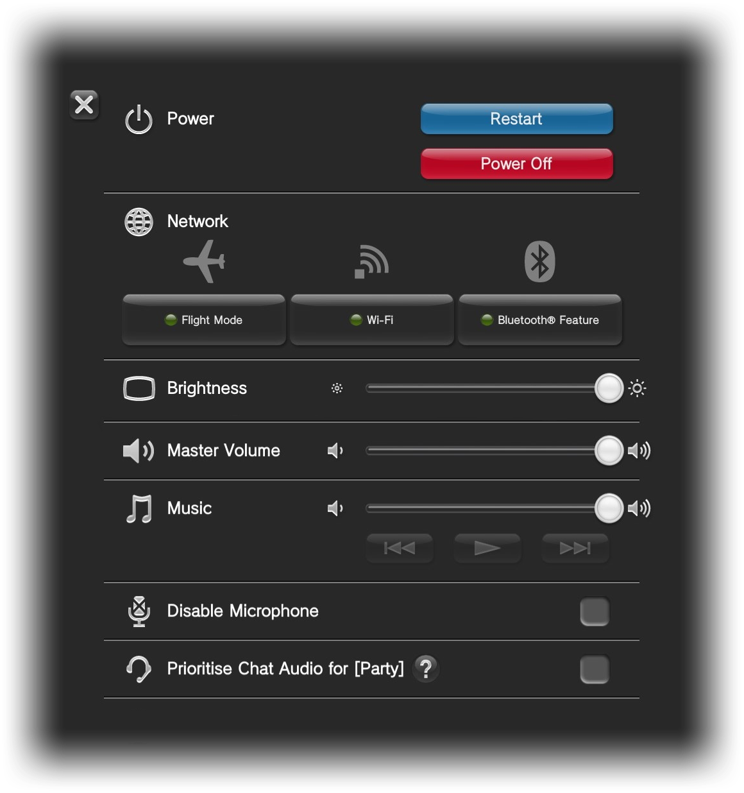
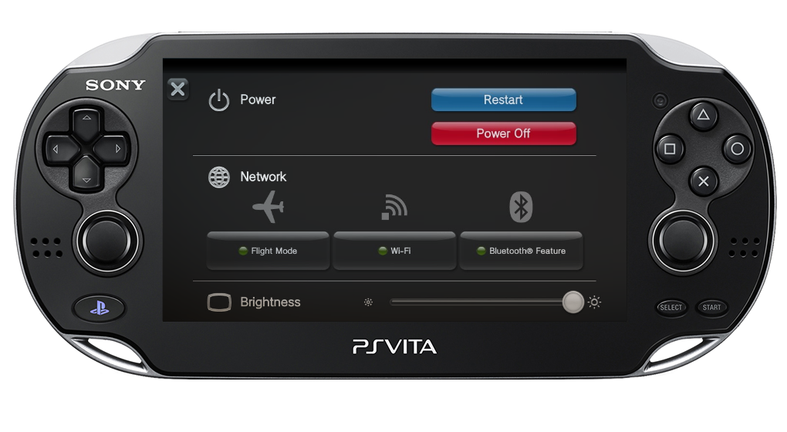
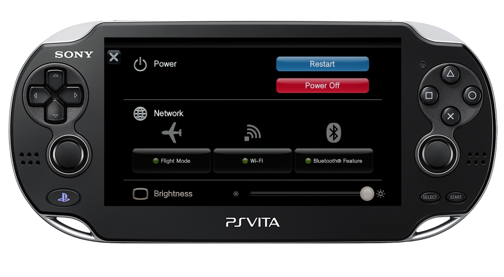

<h1>Quick Menu Minus</h1> 

Quick Menu Minus is a fork of <a href="https://github.com/PsArchive/QuickMenuPlus"> QuickMenuPlus </a> that adds custom enhancements and features to the Quick Menu on the PlayStation Vita and PlayStation TV.

<h3>Key differences from QuickMenuPlus: </h3>
<ul>
  <li><b>No PlayStation Plus logos/icons:</b> Completely removed PS Plus visual branding for a cleaner look.</li>
  <li>Updated Background Logic (<code>bgstyle.txt</code>):</li>  
    <ul>
      <li><code>0</code> = Transparent </li>
      <li><code>1</code> = Gray </li>
      <li><code>2</code> = Black</li>  
    </ul>
  <li><b>Disabled Gradient by Default</b> (<code>bggradient.txt</code>)<b>:</b> The background gradient effect is now disabled by default. To enable it, create the file and set its value to <code>1</code>.</li>
</ul>

  

<h2>Installation</h2>

Supported firmware versions:

<ul>
  <li>Retail 3.60-3.73</li>
  <li>Testkit 3.60, 3.65</li>
  <li>Devkit 3.60</li>
</ul>

Write the file path in the <code>*main</code> section of your taiHEN config.

<pre><code class="language-bash">*main                        
ur0:/tai/quickmenuminus.suprx
</code></pre>
 

<h2>Configuration</h2>

Put files in the directory <code>ur0:/data/quickmenuminus</code> to configure Quick Menu Minus.

<ul>
  
<li> <code>pushtime.txt</code> sets the Quick Menu PS button push time. Put in the file the desired push time in microseconds. For example, put <code>250000</code> for 250 milliseconds. If the file does not exist, the default time is 500 milliseconds.</li>

<li> <code>standbyisrestart.txt</code> sets the standby button to function as a restart button. Put in the file <code>1</code> to enable, or <code>0</code> to disable. If the file does not exist, the default is enabled on the Vita, and disabled on the PSTV. When this setting is disabled, hold the "Power Off・Restart" button to restart, and press to power off.</li>

   

    
  
 

<li> <code>bgstyle.txt</code> sets the background style. Put in the file <code>0</code> for transparent, <code>1</code> for gray, and <code>2</code> for black. If the file does not exist, the default is transparent (<code>0</code>). Black can reduce power consumption for OLED screens.</li> 

  

  	  
      
     
  

<li> <code>bggradient.txt</code> sets the background gradient effect. Put in the file <code>0</code> to disable, and <code>1</code> to enable. If the file does not exist, the default is disabled (<code>0</code>). </li>
</ul>
 

 <h2>Building</h2>

Dependencies:

<ul>
 <li><a href="https://vitasdk.org">VitaSDK</a></li>
 <li><a href="https://github.com/VitaArchive/ScePaf-RE/tree/c-compat">paf-RE</a></li>
</ul>

Logging can be configured with CMake variables.

To build dependencies and module:

<pre><code class="language-bash">cmake -S . -B build -DCMAKE_BUILD_TYPE=Release
cmake --build build</code></pre>

<h2>Contributing</h2>

Feel free to open issues and pull requests for the project!

<h2>Credits</h2>
<ul>
<li>Princess-of-Sleeping: Tip for SceShellUtil, ScePaf</li>
<li>Team CBPS: For the original project</li> 
</ul>

<h2>See also</h2>
    <a href="https://github.com/PsArchive/QuickMenuPlus">Original repository</a>

